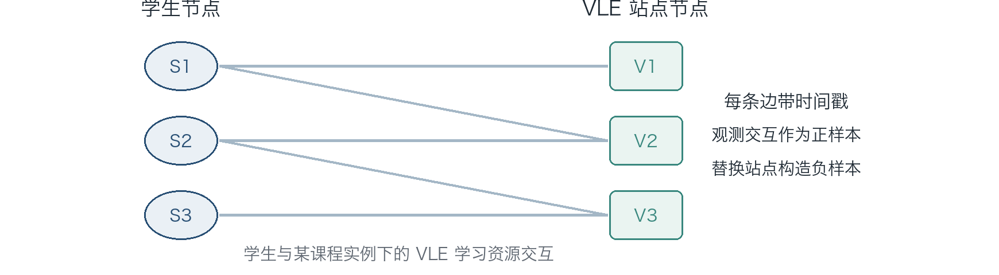
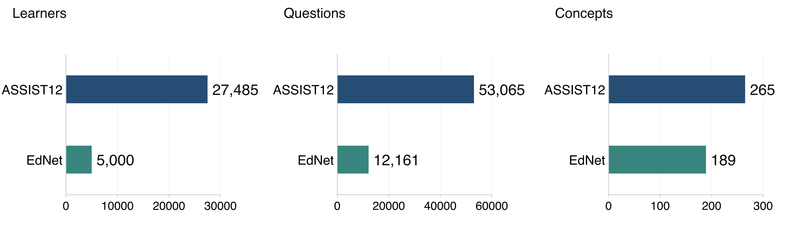

# EduTGT 前期材料与教育数据集及参考论文整理

历史背景说明（2026-10-29）：本文记录旧 EduTGT 的时序交互预测尝试及参考资料，用于说明方向调整的背景。文中“EduTGT 当前仓库”均指下列固定提交的旧实现；新方向以本分支的知识追踪实验代码与运行说明为准。

整理日期：2026 年 10 月 27 日  
EduTGT 仓库核对版本：`main`，提交 `550210d223b1927c584544023432b87dc7ab90a6`  
数据集原稿：`2026-0824-Hypergraph convolution with multi-scale feature-cr.docx`

本材料整理 EduTGT 的数据组织、对比方法和代码配置，以及 FC-HGNN 原稿中的 ASSIST12、EdNet 两套数据集。文末列出相关参考论文，每篇说明研究内容与本项目可借鉴的部分。**实验结果暂不列入，待找到对应记录后补充。**

## 1 任务和材料范围

目前涉及两类教育任务，数据实体与预测标签需要分别说明。

| 内容 | EduTGT 当前仓库 | 所给 FC-HGNN 原稿 |
|---|---|---|
| 数据 | OULAD | ASSIST12、EdNet |
| 主要实体 | 学生、课程实例、VLE 学习资源站点 | 学习者、题目、知识点 |
| 记录内容 | 学生在课程学习过程中访问学习资源 | 学生作答及对应的正确性 |
| 当前预测任务 | 给定学生、候选资源和时间，对交互边打分 | 根据学生的历史作答预测后续作答正确性 |
| 标签含义 | 观测交互作为正样本，替换候选终点构造负样本 | 正确与错误作答 |
| 本材料整理范围 | 数据结构、方法实现、对比和探索设置、配置口径 | 数据来源、样本规模、字段背景与处理信息 |

后文涉及知识追踪论文时，“可用点”表示结合本项目提出的对接用途，**不表示这些方法已经接入 EduTGT，也不表示已经验证其效果**。资源访问记录本身不能直接解释为学生已经掌握或没有掌握某个知识点。

## 2 前期 EduTGT 使用的数据

### 2.1 数据来源及原始表

EduTGT 使用 OULAD 教育学习行为数据。该数据将课程、学生属性、注册信息、考核记录和虚拟学习环境 VLE 中的资源访问记录分表保存。当前 EduTGT 的任务围绕学生与 VLE 站点之间的时序交互展开。

仓库历史版本的数据说明列出了以下原始表记录数：

| 原始表 | 记录数 | 主要内容 | 关键字段示例 |
|---|---:|---|---|
| `courses` | 22 | 课程模块及开课批次 | `code_module`、`code_presentation`、`module_presentation_length` |
| `studentInfo` | 32,593 | 学生在课程实例中的属性与最终结果 | `id_student`、课程标识、`gender`、`age_band`、`highest_education`、`final_result` |
| `studentRegistration` | 32,593 | 学生注册与退课日期 | `id_student`、课程标识、`date_registration`、`date_unregistration` |
| `vle` | 6,364 | 学习资源及其活动类型 | `id_site`、课程标识、`activity_type`、`week_from`、`week_to` |
| `studentVle` | 10,655,280 | 学生按日汇总的资源访问记录 | `id_student`、课程标识、`id_site`、`date`、`sum_click` |
| `assessments` | 206 | 考核类型、日期与权重 | `id_assessment`、课程标识、`assessment_type`、`date`、`weight` |
| `studentAssessment` | 173,912 | 学生提交考核的记录及成绩 | `id_student`、`id_assessment`、`date_submitted`、`score` |

这里的“记录数”指原始表行数。`studentInfo` 中同一学生可以对应不同课程实例，32,593 不能直接作为独立学生人数；10,655,280 也不是某次 EduTGT 实验实际使用的边数。`studentVle` 按日汇总点击，`sum_click` 表示该记录的点击量，不能把一行解释为一次具有精确时刻的独立点击。

来源：[仓库历史 OULAD 数据说明](https://github.com/FLTing404/EduTGT/blob/bc43ce71db96a4242ddeb215a21fea320167d957/OULAD-main/README.md)、[OULAD 数据论文](https://www.nature.com/articles/sdata2017171.pdf)。

### 2.2 课程模块与课程实例

使用指南列出的处理范围包含 `AAA` 至 `GGG` 七个课程模块，以及白名单内的部分单独课程实例。例如，`AAA` 表示整模块，`AAA-2013J` 表示该模块的一个开课批次。

课程实例由 `code_module` 与 `code_presentation` 共同区分。分析学生与资源的关系时，需要保留这个上下文，避免把不同开课批次中的同名资源或时间含义混在一起。

这些是使用指南规定的处理范围，不能据此认定七个模块已经全部完成实验。具体实验样本规模应读取相应数据目录中的 `stats.json`，并与运行日志中的 `data_name` 对应。

### 2.3 学生与 VLE 站点的构图方式

当前使用指南将数据组织为时序二部图：

| 图中对象 | 含义 |
|---|---|
| 源节点 `u` | 学生 |
| 终点节点 `i` | 特定课程实例下的 VLE 站点 |
| 观测边 | 某学生在某个课程相对日期访问该站点 |
| 时间戳 `ts` | 由课程实例序号与课程相对日期构造的时间编码 |
| 节点特征 | 学生属性与资源活动类型等特征 |
| 正样本 | 数据中观测到的学生—站点交互 |
| 负样本 | 保留源节点与时间，替换终点站点形成的候选边 |



*图 1 学生—VLE 站点交互结构示意。图中的节点数量、编号和连线仅用于说明结构，不代表真实样本。*

按使用指南，交互在学生、课程实例、站点和日期层面聚合，时间编码为：

```text
ts = pres_index × 1000 + date
```

其中，`pres_index` 表示课程实例序号，`date` 表示课程相对日期。因此，`ts` 是项目构造的排序编码，不能直接当作 Unix 时间戳或真实日历时刻。

观测边文件中的 `label=1` 与训练时构造的二分类标签也需要区分：原文件保存已发生的交互，训练和评估再通过负采样加入候选负边。采样负边表示当前协议下的对照候选，不等于数据集明确标注的“学生不会访问该资源”。

来源：[使用指南的数据格式与处理说明](https://github.com/FLTing404/EduTGT/blob/550210d223b1927c584544023432b87dc7ab90a6/docs/使用指南.md)。

### 2.4 数据文件与节点特征

使用指南约定的数据目录及文件如下：

```text
data/processed/data_<模块或实例>/
├── ml_<名称>.csv          # 带时间戳的边表
├── <名称>.content        # 节点特征矩阵
├── node_map.csv          # 内部节点编号与原始标识的映射
├── stats.json            # 学生数、站点数、边数等统计
├── pres_relation.json    # 课程实例之间的站点集合关系
└── *_idx.txt             # 各数据切分的边下标
```

边表核心字段：

| 字段 | 含义 |
|---|---|
| `u` | 源节点编号，表示学生 |
| `i` | 终点节点编号，表示 VLE 站点 |
| `ts` | 交互时间编码 |
| `label` | 观测交互标记 |
| `idx` | 边记录索引 |

使用指南将节点特征列为 71 维，包含学生人口属性和 VLE 活动类型等；模型读取时补零到 4 的倍数，以满足多头注意力的维度要求。现有资料没有给出完整的 71 维逐列构成，本文不另外推定每一维的来源。

当前提交没有包含 `data/` 目录，指南提到的预处理脚本也未随该目录提交。因此，本节的预处理与文件约定依据仓库说明整理；已提交并可核查的部分包括数据读取、时间切分、模型、采样及训练代码。

### 2.5 时间切分与新节点测试

`utils.Dataset` 取全部边时间戳的 10% 和 20% 分位点作为两个边界，得到按时间排列的训练、验证和测试窗口。

| 切分 | 时间范围 | 约占全部边的比例 |
|---|---|---:|
| 训练集 | `ts ≤ 第一个边界` | 10% |
| 验证集 | `第一个边界 < ts ≤ 第二个边界` | 10% |
| 测试集 | `ts > 第二个边界` | 80% |

上述比例是按分位点理解的近似值，同一时间戳存在多条记录时，实际边数比例会变化。该规则属于时间外推切分，不应写成常见的随机 80%/10%/10% 划分。

`nn_test` 是测试集中的新节点子集：一条测试边至少有一个端点未在训练边中出现，就进入该子集。它用于记录含训练未见节点的交互情况，与完整测试集需要分别报告。

来源：[数据读取与切分源码](https://github.com/FLTing404/EduTGT/blob/550210d223b1927c584544023432b87dc7ab90a6/utils.py)。

## 3 EduTGT 的方法与对比设置

### 3.1 主体模型如何处理一条交互

主体模型名为 `SpatialTemporal`。对一条待评分的学生—站点边，模型分别提取交互双方的空间邻居和历史交互序列。

1. **空间分支**：从节点历史邻接事件中采样邻居，结合节点特征与时间间隔，通过多头注意力编码其局部关系。
2. **时间分支**：沿节点自身的历史交互序列采样，用独立的编码器处理行为随时间的变化。
3. **表示合并**：分别取两个分支的首位置表示和后续位置平均表示，拼接后通过 MLP 与归一化得到节点表示。
4. **链路评分**：合并源节点与候选终点的表示，通过预测头输出交互分数。

这里的“空间”表示图中的邻接关系，不是学生的地理位置；“时间”表示事件历史及相对间隔。

来源：[主体模型](https://github.com/FLTing404/EduTGT/blob/550210d223b1927c584544023432b87dc7ab90a6/model.py)、[注意力编码器](https://github.com/FLTing404/EduTGT/blob/550210d223b1927c584544023432b87dc7ab90a6/graph_transformer.py)、[历史采样](https://github.com/FLTing404/EduTGT/blob/550210d223b1927c584544023432b87dc7ab90a6/sampling.py)。

### 3.2 预训练与微调

**预训练阶段**使用训练时间窗中的交互，并构造空间、时间两个视图的增强序列。可学习的 Top-k 选择模块从扩展序列中选取元素，主体编码器通过原始视图、增强视图和负样本之间的约束学习表示。该阶段保存预训练权重，供后续微调加载。

**微调阶段**加载时空编码器的预训练权重，对观测正边和替换终点构造的负边使用二元交叉熵 BCE 训练，并依据验证集 AP 选择模型。预训练和微调是两个阶段，不能用一个命令行默认参数表代替全部实际设置。

当前源码中，预训练的空间、时间采样长度分别硬编码为 `30`、`21`；微调脚本读取通用参数，其默认值分别为 `40`、`31`。预训练优化器的学习率也直接写为 `0.001`，需要与命令行参数的含义区分。

来源：[预训练源码](https://github.com/FLTing404/EduTGT/blob/550210d223b1927c584544023432b87dc7ab90a6/pretrain.py)、[微调参照](https://github.com/FLTing404/EduTGT/blob/550210d223b1927c584544023432b87dc7ab90a6/methods/main.py)。

### 3.3 EduTGT 的课程实例关系偏置采样

EduTGT 的主方法保留时空编码框架，使用课程实例之间的资源集合关系调整训练负样本的终点采样概率。

对两个课程实例，先比较它们使用的站点 `id_site` 集合。关系矩阵采用 Jaccard 相似度：

```text
两个实例的关系权重 = 站点集合交集大小 / 站点集合并集大小
```

对当前正边所属的课程实例，候选负站点的权重取决于它所属实例与当前实例的关系。随后，将按关系得到的分布与均匀分布混合。默认 `pres_mix_uniform=0.35`，表示混入 35% 的均匀采样成分。

这项修改的作用位置是**训练负采样**，没有额外定义另一套时空编码器。预训练脚本在读取到相应关系文件时也会使用该采样器，因此记录实验时，需要同时说明预训练和微调是否启用了课程实例关系。

来源：[关系矩阵及偏置采样实现](https://github.com/FLTing404/EduTGT/blob/550210d223b1927c584544023432b87dc7ab90a6/course_pres.py)、[EduTGT 主方法入口](https://github.com/FLTing404/EduTGT/blob/550210d223b1927c584544023432b87dc7ab90a6/methods/main_ablation_pres_relation.py)。

### 3.4 仓库中的对比方法

| 方法 | 主要比较内容 | 当前仓库实现范围 | 入口 |
|---|---|---|---|
| EduTGT | 在时空双路模型中引入课程实例关系偏置负采样 | 项目主方法 | `methods/main_ablation_pres_relation.py` |
| ContraTGT 参照 | 使用同类时空编码框架与均匀训练负采样 | 项目中的微调参照入口 | `methods/main.py` |
| TGN | 通过节点记忆和消息更新维护动态状态 | 使用 PyG `TGNMemory` 的轻量实现，没有完整复用原作者的全部邻域建模流程 | `baseline/tgn/` |
| TGAT | 用时间感知注意力聚合历史邻居 | 项目独立编写的简化实现，未直接复用作者完整训练流程 | `baseline/tgat/` |
| JODIE 风格 | 用递归更新维护交互双方的动态表示 | 精简实现，未完整包含原论文的未来轨迹投影与 t-Batch 流程 | `baseline/tncn/` |

两处命名和来源需要说明：

- `baseline/tncn/` 目录实际运行的是 JODIE 风格方法，不能把目录名直接当作已实现 TNCN。
- TGAT 作者公开仓库使用 **PyTorch**。EduTGT 的相关说明中存在“官方 TensorFlow”的表述，本文以作者仓库为准，不沿用该描述。

来源：[基线目录](https://github.com/FLTing404/EduTGT/tree/550210d223b1927c584544023432b87dc7ab90a6/baseline)、[TGAT 作者代码](https://github.com/StatsDLMathsRecomSys/Inductive-representation-learning-on-temporal-graphs)。

### 3.5 代码中的探索与消融入口

| 设置 | 调整内容 | 整理时的准确表述 |
|---|---|---|
| 学生时序一致性 | 对同一 batch 内同学生的源端表示加入一致性约束，默认损失权重 `0.1` | 学生表示一致性约束的探索入口 |
| 时序历史采样 | 将 `tmp_sample` 设为 `1` | 缩短历史采样的对照；源码并没有直接删除时间编码器 |
| 时间戳归一化 | 对全图时间戳做最小值、最大值归一化，并保留课程实例关系偏置采样 | 全图时间归一化的探索入口，不能称为按各课程长度归一化 |

这些条目记录仓库提供的设置，不作为已完成实验的证明。后两项在正式运行前还需核查实现：采样长度为 1 时后续位置均值可能涉及空序列，归一化时间回写整型张量也可能发生截断。

来源：[消融批跑脚本](https://github.com/FLTing404/EduTGT/blob/550210d223b1927c584544023432b87dc7ab90a6/run_ablation_batch.py)、[时空模型](https://github.com/FLTing404/EduTGT/blob/550210d223b1927c584544023432b87dc7ab90a6/model.py)、[归一化时间入口](https://github.com/FLTing404/EduTGT/blob/550210d223b1927c584544023432b87dc7ab90a6/methods/main_ablation_course_progress.py)。

### 3.6 代码配置与后续记录口径

下表是代码设置及默认值，不是已确认的某次实验配置。

| 配置项 | 预训练 | 主方法及 ContraTGT 微调参照 | TGN、TGAT、JODIE 基线批跑 |
|---|---|---|---|
| 训练轮数上限 | 通用默认 `50` | 通用默认 `50` | 默认 `50` |
| Batch size | 通用默认 `800` | 通用默认 `800` | 默认 `200` |
| 学习率 | 优化器写为 `0.001` | 默认 `0.001` | 默认 `0.001` |
| 空间采样长度 | 源码写为 `30` | 默认 `40` | 由各模型实现处理 |
| 时间采样长度 | 源码写为 `21` | 默认 `31` | 由各模型实现处理 |
| Dropout | 通用参数默认 `0.2` | 默认 `0.2` | 由各模型参数决定 |
| 模型选择 | 预训练主体损失 | 验证集 AP | 各 runner 的验证选择流程 |
| 随机种子 | 通用默认 `60` | 通用默认 `60`；消融批跑另设种子列表 | 批跑默认 `42` |

后续补充实验时，除了超参数，还需要统一负采样和指标计算方式。当前代码中存在以下差异：

| 项目 | 主方法及微调参照 | 三个外部方法基线 |
|---|---|---|
| 验证、测试负样本终点池 | 全图中出现的终点集合 | 训练边中出现的终点集合 |
| AUC、AP、ACC 聚合 | 各 batch 分别计算后取平均 | 拼接整个 split 的预测后统一计算 |

因此，现阶段可以写“复用数据接口和时间切分”，不能写“负采样与指标计算完全一致”。这里仅记录比较口径，不列具体分数。

来源：[通用参数与数据读取](https://github.com/FLTing404/EduTGT/blob/550210d223b1927c584544023432b87dc7ab90a6/utils.py)、[主方法评估](https://github.com/FLTing404/EduTGT/blob/550210d223b1927c584544023432b87dc7ab90a6/methods/main.py)、[基线公共接口](https://github.com/FLTing404/EduTGT/tree/550210d223b1927c584544023432b87dc7ab90a6/baseline/common)。

## 4 ASSIST12 与 EdNet 两套数据集

### 4.1 原稿报告的实验规模

所给 FC-HGNN 原稿在第 4.1 节和表 2 中介绍 ASSIST12 与 EdNet。可明确提取的三项规模如下：

| 统计项 | ASSIST12 | EdNet | 统计口径 |
|---|---:|---:|---|
| 学习者数 | 27,485 | 5,000 | 原稿实验使用规模 |
| 题目数 | 53,065 | 12,161 | 原稿实验涉及题目 |
| 知识点数 | 265 | 189 | 原稿实验涉及概念 |



*图 2 原稿表 2 的学习者、题目和知识点规模。三个面板分别使用独立数轴，不能通过不同面板的柱长比较不同单位。*

上述统计描述原稿中的实验数据，不能作为两个公开数据集完整发布包的规模。尤其是 EdNet，原稿列出的 5,000 名学习者属于其使用样本。

### 4.2 ASSIST12 的数据内容

**来源**：ASSISTments 的 2012–2013 学校数据页面，原稿给出的入口为 [2012-13 School Data with Affect](https://sites.google.com/site/assistmentsdata/datasets/2012-13-school-data-with-affect)。

原稿主要描述学生学习行为、题目与逐题作答正确性。官方页面进一步列出了以下原始字段背景，供理解数据结构使用：

| 字段 | 主要含义 | 对本项目整理的作用 |
|---|---|---|
| `user_id` | 学生标识 | 组织学生历史 |
| `problem_id` | 题目标识 | 区分具体练习题 |
| `skill` | 题目关联技能 | 连接题目与知识点 |
| `problem_log_id` | 日志标识 | 识别原始日志记录 |
| `start_time`、`end_time` | 题目开始、结束时间 | 理解作答时间与顺序 |

官方页面说明不同技能可以对应不同记录行。因此，统计作答数、去重题目和处理多知识点时，需要确认行的含义。原稿的正确性预测任务也需要明确一次作答究竟取首答、最终回答，还是其他规则；这些细节不能仅由数据名称推定。

在模型输入层面，ASSIST12 可以围绕“学生历史—题目—知识点—正确性”组织。若用于超图结构建模，可将关联同一知识点的题目组织成关系集合；若用于时序图建模，则需要保留事件顺序并重新定义边特征与预测标签。这里是可能的数据组织方式，不代表原稿已公开完整处理流程。

### 4.3 EdNet 的公开数据与原稿样本

**来源**：[riiid/ednet 官方仓库](https://github.com/riiid/ednet)及数据论文 [EdNet: A Large-Scale Hierarchical Dataset in Education](https://arxiv.org/abs/1912.03072)。

EdNet 由 Santa 学习服务收集。数据论文报告全量包含 **784,309 名学生和 131,441,538 条交互**；这些交互覆盖多种学习行为，不能全部解释为逐题作答。原稿中的 5,000 人、12,161 题、189 个知识点是另一层面的实验统计。

公开数据分为四个行为层级：

| 层级 | 主要记录内容 | 可支持的组织方式 |
|---|---|---|
| KT1 | 作答日志 | 学生—题目—作答序列 |
| KT2 | 更细的答题相关动作 | 答题过程中的行为事件 |
| KT3 | 在前述行为上加入解析阅读和讲解学习 | 多类学习资源交互 |
| KT4 | 更完整的系统动作 | 进一步分析异质行为序列 |

KT1 的常见字段包括 `timestamp`、`solving_id`、`question_id`、`user_answer`、`elapsed_time`。题目元数据另含 `correct_answer`、`tags` 等，可用于连接标准答案和知识点信息。若构造正确性标签，需要关联学生答案与题目标准答案；多知识点则需要说明标签的展开或聚合规则。[官方字段说明](https://github.com/riiid/ednet#kt1)

**原稿没有指定其 EdNet 样本属于 KT1、KT2、KT3 还是 KT4，也没有公开 5,000 人的用户清单或抽样种子。** 因此，公开层级的介绍用于说明数据背景，不能据此认定原稿采用了某一层级。

### 4.4 原稿已提供和待核实的信息

| 项目 | ASSIST12 | EdNet |
|---|---|---|
| 数据来源入口 | 已给出 | 已给出 |
| 学习者、题目、知识点规模 | 表 2 已给出 | 表 2 已给出 |
| 总作答或交互数 | 未明确给出 | 未明确给出 |
| 正确、错误标签比例 | 未给出 | 未给出 |
| 缺失知识点和重复作答处理 | 未说明 | 未说明 |
| 多知识点的展开或聚合 | 未说明 | 未说明 |
| 训练、验证、测试比例 | 未明确 | 未明确 |
| 按学生还是按事件划分 | 未明确 | 未明确 |
| 样本抽取方法与种子 | 未明确 | 5,000 人的抽样规则未明确 |
| 具体发布层级 | 不涉及 EdNet 式层级 | 未指定 KT1 至 KT4 |

原稿泛称使用交叉验证和网格搜索，但未给出具体折数和搜索范围。后续若进行复现或统一比较，需要把这些数据处理信息单独固定，不能从本地其他实验配置反填为原稿设置。

### 4.5 原表中暂不作为可靠规模使用的统计

原稿表 2 还列出三行派生统计，保留其原值以便核对：

| 原表字段 | ASSIST12 | EdNet | 需要核对的内容 |
|---|---:|---:|---|
| `Questions per knowledge concept` | 200 | 147 | 计算口径未说明；尤其 EdNet 不能仅由所列题目数和知识点数解释 |
| `Knowledge concepts per question` | 1,000 | 2,280 | 数值超过表中的知识点总数，字段含义或排版需要核对 |
| `Attempts per question` | 51 | 56 | 平均次数的分母、是否取整及样本范围未说明 |

图 2 只采用前三项明确规模。本文没有用“题目数 × 平均作答次数”反推总交互数，也没有将上述可疑字段改写为其他含义。

## 5 已找到的参考论文及本项目可用点

本节按用途列出参考文献。每篇的“内容”只概括方法或数据工作，不摘录其性能结论；“可用点”是结合本项目提出的用途。除当前仓库明确存在的方法外，其余均属于参考候选。

### 5.1 EduTGT 当前任务直接相关的时序图论文

#### R01 ContraTGT

**题名与出处**：*Learnable Data Augmentation and Contrastive Pre-training for Temporal Link Prediction*，IJCAI 2026 Main Track。[正式论文](https://ijcai.org/proceedings/2026/303)

- **一句话概括**：通过空间与时间双视图 Transformer 配合可学习序列增强，进行时序链路预测的对比预训练。
- **本项目可用点**：作为 EduTGT 时空编码和预训练主线的直接方法来源，帮助标明沿用的框架与课程实例关系采样扩展分别位于哪里。

#### R02 TGN

**题名与出处**：*Temporal Graph Networks for Deep Learning on Dynamic Graphs*，ICML 2020 Workshop on Graph Representation Learning。[论文](https://arxiv.org/abs/2006.10637)、[作者代码](https://github.com/twitter-research/tgn)

- **一句话概括**：将节点记忆、事件消息更新与图表示算子结合，处理连续时间的动态图事件序列。
- **本项目可用点**：为学生和资源的动态历史状态提供记忆建模对照；当前仓库已有轻量 Memory 实现，整理时应注明其与原方法完整流程的范围差异。

#### R03 TGAT

**题名与出处**：*Inductive Representation Learning on Temporal Graphs*，ICLR 2020。[论文](https://arxiv.org/abs/2002.07962)、[作者代码](https://github.com/StatsDLMathsRecomSys/Inductive-representation-learning-on-temporal-graphs)

- **一句话概括**：利用函数时间编码和注意力聚合历史邻域，形成具有时间信息的归纳式节点表示。
- **本项目可用点**：用于对照时间感知邻居聚合，也为训练未见节点的测试提供方法背景；当前仓库是独立简化实现。

#### R04 JODIE

**题名与出处**：*Predicting Dynamic Embedding Trajectory in Temporal Interaction Networks*，KDD 2019。[论文](https://arxiv.org/abs/1908.01207)、[作者项目页](https://snap.stanford.edu/jodie/)

- **一句话概括**：通过耦合递归网络更新用户和物品的动态表示，并投影未来时刻的表示轨迹。
- **本项目可用点**：用户—物品双侧交互与学生—资源二部图相近，可作为动态嵌入路线参照；当前项目的 JODIE 风格实现没有包含其全部机制。

### 5.2 数据来源论文

#### R05 OULAD 数据论文

**题名与出处**：*Open University Learning Analytics dataset*，Scientific Data 2017。[出版方论文](https://www.nature.com/articles/sdata2017171.pdf)、[DOI](https://doi.org/10.1038/sdata.2017.171)

- **一句话概括**：介绍将学生属性、课程、考核和按日汇总的 VLE 点击记录关联起来的开放学习分析数据集。
- **本项目可用点**：用于核实课程实例、原始表关联键和点击记录粒度，避免把每日汇总访问解释为逐题作答或逐次点击。

#### R06 EdNet 数据论文

**题名与出处**：*EdNet: A Large-Scale Hierarchical Dataset in Education*，AIED 2020，预稿于 2019 年公开。[论文](https://arxiv.org/abs/1912.03072)、[数据仓库](https://github.com/riiid/ednet)

- **一句话概括**：发布包含多种学生系统交互、并按四个行为层级组织的大规模教育数据。
- **本项目可用点**：用于区分原稿 5,000 人样本与公开全集，并明确后续采用作答序列还是多行为资源交互。

### 5.3 原稿基线与知识追踪序列对照

以下方法主要适用于 ASSIST12、EdNet 的作答正确性预测。迁移到当前 OULAD 资源站点任务时，需要重新明确输入与标签语义。

#### R07 BKT

**题名与出处**：*Knowledge tracing: Modeling the acquisition of procedural knowledge*，User Modeling and User-Adapted Interaction，1994。[出版方论文](https://link.springer.com/article/10.1007/BF01099821)

- **一句话概括**：在学生练习过程中，根据观测表现持续更新其掌握知识规则的概率。
- **本项目可用点**：作为作答 KT 的传统概率基线，提供知识点掌握状态及其逐步更新的清楚参照。

#### R08 DKT

**题名与出处**：*Deep Knowledge Tracing*，NeurIPS 2015。[会议论文](https://papers.nips.cc/paper/2015/hash/bac9162b47c56fc8a4d2a519803d51b3-Abstract.html)

- **一句话概括**：使用递归神经网络编码学生的历史作答，预测之后的练习表现。
- **本项目可用点**：作为不依赖显式图传播的序列参照，帮助区分历史序列信息与额外图结构信息的作用。

#### R09 DKVMN

**题名与出处**：*Dynamic Key-Value Memory Networks for Knowledge Tracing*，WWW 2017。[会议论文](https://archives.iw3c2.org/www2017/proceedings/proceedings/p765.pdf)

- **一句话概括**：以静态键记忆表示概念、动态值记忆更新学生状态，显式区分概念与掌握信息。
- **本项目可用点**：为知识点层的状态存储和读取提供记忆网络对照，也可用于说明学生状态与题目表示的分工。

#### R10 SAINT

**题名与出处**：*Towards an Appropriate Query, Key, and Value Computation for Knowledge Tracing*，Learning @ Scale 2020。[论文](https://arxiv.org/abs/2002.07033)、[正式 DOI](https://doi.org/10.1145/3386527.3405945)

- **一句话概括**：将题目和作答响应分别输入 Transformer 编码器与解码器，组织知识追踪中的注意力计算。
- **本项目可用点**：作为原稿已列出的注意力基线，便于对照题目信息与历史响应分开编码的方式。

#### R11 AKT

**题名与出处**：*Context-Aware Attentive Knowledge Tracing*，KDD 2020。[正式论文](https://doi.org/10.1145/3394486.3403282)、[作者全文](https://people.umass.edu/~andrewlan/papers/20kdd-akt.pdf)

- **一句话概括**：结合上下文相关距离、注意力衰减和题目差异表示，建模历史作答对当前题目的影响。
- **本项目可用点**：可作为作答 KT 的注意力对照，并参考其历史相关性、距离衰减和同知识点内题目差异的建模。

#### R12 simpleKT

**题名与出处**：*simpleKT: A Simple But Tough-to-Beat Baseline for Knowledge Tracing*，ICLR 2023。[OpenReview 论文](https://openreview.net/pdf?id=9HiGqC9C-KA)、[作者预稿](https://arxiv.org/abs/2302.06881)

- **一句话概括**：用题目个体差异表示和普通点积注意力构成结构较简洁的知识追踪基线。
- **本项目可用点**：便于固定输入条件与训练预算，建立复杂图模块之外的清楚序列对照。

#### R13 DTransformer

**题名与出处**：*Tracing Knowledge Instead of Patterns: Stable Knowledge Tracing with Diagnostic Transformer*，WWW 2023。[正式论文](https://doi.org/10.1145/3543507.3583255)、[作者代码](https://github.com/yxonic/DTransformer)

- **一句话概括**：从题目层表示诊断知识层状态，并通过对比训练约束状态表示的稳定性。
- **本项目可用点**：可作为 KT 序列模型对照，参考题目层到知识层的表示组织，以及历史扰动前后的状态分析。

### 5.4 图与超图知识追踪相关论文

本组与原稿的高阶关系建模有关。其中，部分文献目前依据作者预稿或出版方公开摘要整理，不据摘要推断完整清洗协议或官方代码情况。

#### R14 DGEKT

**题名与出处**：*DGEKT: A Dual Graph Ensemble Learning Method for Knowledge Tracing*，ACM TOIS 2024。[正式论文](https://doi.org/10.1145/3638350)、[作者预稿](https://arxiv.org/abs/2211.12881)、[作者代码](https://github.com/Yumo216/DGEKT)

- **一句话概括**：将知识点关联超图与作答先后转移有向图结合，并通过在线知识蒸馏融合两路模型。
- **本项目可用点**：可作为 FC-HGNN 方向的结构对照，分别组织概念关联和行为转移；涉及作答转移的图需要限定构建数据范围。

#### R15 HyperKT

**题名与出处**：*Dual-Channel Adaptive Scale Hypergraph Encoders With Cross-View Contrastive Learning for Knowledge Tracing*，IEEE TNNLS 2025 卷期。[正式论文](https://doi.org/10.1109/TNNLS.2024.3386810)

- **一句话概括**：结合自适应超边、全局与局部双通道编码，以及超图和线图之间的跨视图对比学习。
- **本项目可用点**：用于梳理多尺度超图、全局局部关系和跨视图融合的已有设计，明确原稿中相关模块的具体位置与实现范围。

#### R16 HSEKT-GS

**题名与出处**：*HSEKT-GS: Hypergraph structure-enhanced for knowledge tracing with gumbel-softmax sampling*，Knowledge-Based Systems 2026 卷期。[出版方页面](https://www.sciencedirect.com/science/article/pii/S0950705125018246)

- **一句话概括**：使用题目—概念超图、对偶关系及 Gumbel-Softmax 结构采样，学习局部和潜在全局关系。
- **本项目可用点**：可参考固定题目—概念结构之外的可学习关系，以及结构采样与正则化的组织方法；具体迁移需先确定可用关联信息。

#### R17 MHAKT

**题名与出处**：*Enhancing Knowledge Tracing with Multi-hierarchy Hypergraph Adaptive Knowledge Transfer*，ACM TOIS 2026。[正式论文](https://doi.org/10.1145/3803860)

- **一句话概括**：使用多层级超图组织知识关联，并结合自适应知识迁移更新学生状态。
- **本项目可用点**：当数据具有知识点与更高层知识领域标签时，可参考分层关系编码；当前原稿的知识点数量不能直接替代层级标签。

#### R18 THyMeN

**题名与出处**：*Augmenting knowledge tracing through modeling dynamic higher-order concept interactions: A temporal hypergraph memory network*，Computers and Education: Artificial Intelligence，2026。[出版方页面](https://www.sciencedirect.com/science/article/pii/S2666920X26000780)

- **一句话概括**：将学生历史组织为随时间变化的多概念超图，并与概念记忆结合以描述题目中的概念组合。
- **本项目可用点**：可参考动态概念组合、题目与概念双向消息传递和记忆融合，作为静态关联结构之外的建模候选。

#### R19 DyGKT

**题名与出处**：*DyGKT: Dynamic Graph Learning for Knowledge Tracing*，KDD 2024。[正式论文](https://doi.org/10.1145/3637528.3671773)、[作者全文](https://arxiv.org/html/2407.20824v1)、[作者代码](https://github.com/PengLinzhi/DyGKT)

- **一句话概括**：将学生作答组织为连续时间动态图，结合长短时间间隔编码与重复交互信息预测正确性。
- **本项目可用点**：连接 EduTGT 的时序二部图框架与 KT 数据，可借鉴交互双方历史、重复练习与时间编码；迁移时需要把访问边任务改为作答正确性任务。

#### R20 GRKT

**题名与出处**：*Leveraging Pedagogical Theories to Understand Student Learning Process with Graph-based Reasonable Knowledge Tracing*，KDD 2024。[作者预稿](https://arxiv.org/abs/2406.12896)、[作者代码](https://github.com/JJCui96/GRKT)

- **一句话概括**：通过图结构表达概念之间的影响，并把状态更新分为知识提取、记忆强化和学习遗忘三个阶段。
- **本项目可用点**：可参考概念状态更新的可解释组织方式；在 OULAD 访问任务中，只能借鉴动态状态设计，不能直接把访问等同于知识掌握。

### 5.5 前期收集的表示学习与近期 KT 方法

下列 Q-MCKT、sparseKT、LefoKT、UKT、KeenKT、GOOD，以及上一组的 DyGKT、GRKT、DTransformer，对应本地已保存的九篇 KT 论文。

#### R21 Q-MCKT

**题名与出处**：*A Question-centric Multi-experts Contrastive Learning Framework for Improving the Accuracy and Interpretability of Deep Sequential Knowledge Tracing Models*，2024 年公开预稿。[作者预稿](https://arxiv.org/abs/2403.07322)、[作者代码](https://github.com/rattlesnakey/Q-MCKT)

- **一句话概括**：同时建模题目级和概念级状态，结合多专家、题目中心对比学习与可解释预测层。
- **本项目可用点**：可参考低交互题目的表示学习，以及题目和概念信息分别建模的方式，适用于含题目、概念和对错标签的 KT 扩展。

#### R22 sparseKT

**题名与出处**：*Towards Robust Knowledge Tracing Models via k-Sparse Attention*，SIGIR **2023**。[正式论文](https://doi.org/10.1145/3539618.3592073)、[作者预稿](https://arxiv.org/abs/2407.17097)、[代码工具库](https://github.com/pykt-team/pykt-toolkit)

- **一句话概括**：通过软阈值或 top-K 稀疏注意力，保留较相关的历史交互并减少无关历史的影响。
- **本项目可用点**：可参考长历史中的邻居选择与抗噪设计；若用于学生—VLE 时序图，需要在当前任务下重新定义历史相关性。

本地 PDF 文件名含 `2024`，对应 arXiv 公开时间；正式会议年份按论文首页记为 2023。

#### R23 LefoKT

**题名与出处**：*Rethinking and Improving Student Learning and Forgetting Processes for Attention Based Knowledge Tracing Models*，AAAI 2025。[正式论文](https://ojs.aaai.org/index.php/AAAI/article/view/34998)

- **一句话概括**：通过相对遗忘注意力分离遗忘模式与题目相关性，并处理不断增长的历史序列。
- **本项目可用点**：可参考时间间隔、历史窗口与长度外推的设计，帮助明确长短期行为信息如何进入模型。

#### R24 UKT

**题名与出处**：*Uncertainty-aware Knowledge Tracing*，AAAI 2025。[正式论文](https://ojs.aaai.org/index.php/AAAI/article/view/35007)、[作者代码](https://github.com/UncertaintyForKnowledgeTracing/UKT)

- **一句话概括**：以随机分布嵌入、Wasserstein 自注意力和不确定性感知对比目标描述学生交互状态。
- **本项目可用点**：可参考状态分布和低置信度样本的分析；迁移时需保留其完整分布建模含义，不能把任意方差输出直接称为 UKT。

#### R25 KeenKT

**题名与出处**：*KeenKT: Knowledge Mastery-State Disambiguation for Knowledge Tracing*，AAAI 2026。[正式论文](https://ojs.aaai.org/index.php/AAAI/article/view/39004)、[作者代码](https://github.com/HubuKG/KeenKT)

- **一句话概括**：用 Normal-Inverse-Gaussian 分布及分布距离注意力表示状态，并结合去噪重构和对比学习处理状态歧义。
- **本项目可用点**：在作答 KT 扩展中，可参考同样正确或错误表现背后不同状态的表示方式；当前资源站点访问日志缺少直接的掌握标签。

#### R26 GOOD

**题名与出处**：*Enhancing the Knowledge Tracing via a Plug-In Guided Diffusion Model*，AAAI 2026。[正式论文](https://ojs.aaai.org/index.php/AAAI/article/view/38872)

- **一句话概括**：以知识状态作为条件，通过引导扩散生成目标响应，再组织正确性预测。
- **本项目可用点**：可作为 KT 预测头扩展的参考，明确生成模块与现有序列骨干的接口；是否接入需要另外定义训练和推理流程。

### 5.6 统一数据处理和比较工具

#### R27 pyKT

**题名与出处**：*pyKT: A Python Library to Benchmark Deep Learning Based Knowledge Tracing Models*，NeurIPS 2022 Datasets and Benchmarks Track。[会议论文](https://papers.neurips.cc/paper_files/paper/2022/hash/75ca2b23d9794f02a92449af65a57556-Abstract-Datasets_and_Benchmarks.html)、[作者工具库](https://github.com/pykt-team/pykt-toolkit)

- **一句话概括**：提供知识追踪数据处理、模型实现及评估接口的开源基准工具库。
- **本项目可用点**：后续整理 ASSIST12、EdNet 的统一处理与比较时，可参考其模型接口和协议，减少不同方法之间预处理不一致的问题。

## 6 参考方法和项目内容的对应关系

下表仅帮助查阅可借鉴的内容，不表示已经实施或得到实验支持。

| 本项目内容 | 对应参考 | 可具体查看的部分 |
|---|---|---|
| OULAD 数据来源与事件粒度 | R05 | 数据关联键、课程实例、按日汇总点击 |
| EdNet 层级与样本范围 | R06 | 四层行为组织、作答与其他行为的区分 |
| 时空双路编码与预训练 | R01 | 双视图序列、可学习增强、预训练与微调 |
| 连续时间节点状态 | R02、R04、R19 | 节点记忆、双侧动态表示、重复交互 |
| 时间感知邻居与历史选择 | R03、R22、R23 | 时间编码、稀疏注意力、历史窗口 |
| 基础作答 KT 对照 | R07 至 R13 | 概率、递归网络、记忆和注意力路线 |
| 概念与行为的多关系结构 | R14、R19、R20 | 关联图、转移图、概念状态更新 |
| 多尺度或可学习超图 | R15 至 R18 | 双通道、结构采样、层级关系、动态概念组合 |
| 题目与概念表示 | R11、R12、R21 | 题目个体差异、多专家、低交互题目 |
| 状态不确定性与生成模块 | R24 至 R26 | 分布表示、状态歧义、条件响应生成 |
| 统一 KT 数据与比较接口 | R27 | 数据处理、模型输入、训练和评估协议 |

## 7 材料与出处索引

| 材料 | 位置或链接 | 用途 |
|---|---|---|
| EduTGT 当前仓库 | [固定提交](https://github.com/FLTing404/EduTGT/tree/550210d223b1927c584544023432b87dc7ab90a6) | 核对已提交实现 |
| 使用指南 | [指南](https://github.com/FLTing404/EduTGT/blob/550210d223b1927c584544023432b87dc7ab90a6/docs/使用指南.md) | 数据目录、处理约定与默认参数 |
| 方法说明 | [方法与 ContraTGT 对比](https://github.com/FLTing404/EduTGT/blob/550210d223b1927c584544023432b87dc7ab90a6/docs/方法与ContraTGT对比.md) | 时空模型与训练流程 |
| 原始 OULAD 表统计 | [历史说明](https://github.com/FLTing404/EduTGT/blob/bc43ce71db96a4242ddeb215a21fea320167d957/OULAD-main/README.md) | 原始表行数，非当前实验样本规模 |
| 两套数据集的原稿 | `docs/2026-0824-Hypergraph convolution with multi-scale feature-cr.docx` | 第 4.1 节与表 2 |
| 前期收集的九篇 KT PDF | `docs/papers/knowledge_tracing/` | 对应 R13、R19 至 R26 |
| 本地参考文献记录 | `汇报材料/参考文献.bib` | 文献信息线索，经原始来源核对后使用 |

所给原稿完整题名为 *Hypergraph convolution with multi-scale feature-cross fusion for capturing high-order educational entity relations and talent-economy linkage analysis*。本文将其作为提供的 Word 原稿引用，不另外推定正式发表状态。

Markdown 中的两张图保存在同级 `EduTGT_material_assets/` 文件夹。转发时应保留相对目录，或使用随附的图文打包文件。
